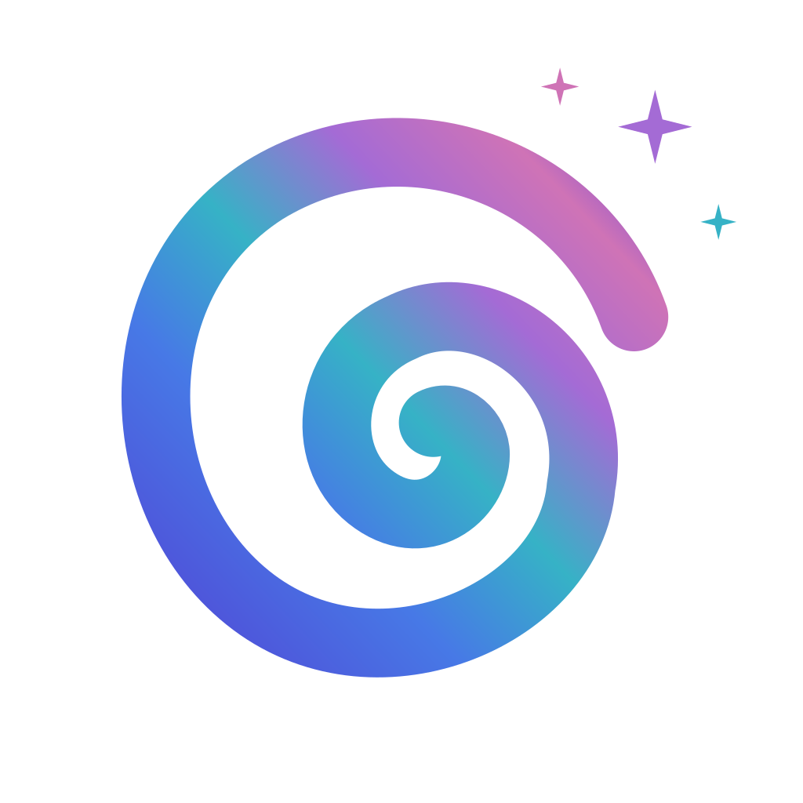

<p align="center">
  
</p>
<h1 align="center">Atoll - DynamicIsland for macOS</h1>
<p align="center">
<a href="https://trendshift.io/repositories/15291" target="_blank"></a>
</p>
<p align="center">
  <a href="https://github.com/Ebullioscopic/Atoll/stargazers">
    
  </a>
  <a href="https://github.com/Ebullioscopic/Atoll/network/members">
    
  </a>
  <a href="https://github.com/Ebullioscopic/Atoll/releases">
    
  </a>
  <a href="https://discord.gg/PaqFkRTDF8">
    
  </a>
</p>

<p align="center">
  <a href="https://github.com/sponsors/Ebullioscopic">
    
  </a>
  <a href="https://github.com/Ebullioscopic/Atoll/releases/latest">
    
  </a>
  <a href="https://www.buymeacoffee.com/kryoscopic">
    
  </a>
</p>

<p align="center">
  <a href="https://discord.gg/PaqFkRTDF8">Join our Discord community</a>
</p>

Atoll turns the MacBook notch into a focused command surface for media, system insight, and quick utilities. It stays out of the way until needed, then expands with responsive, native SwiftUI animations.

<p align="center">
  
</p>


## Highlights
- Media controls for Apple Music, Spotify, Cider, and more with inline previews.
- Live Activities for media playback, Focus, screen recording, privacy indicators, downloads (beta), and battery/charging.
- Lock screen widgets for media, timers, charging, Bluetooth devices, and weather.
- Lightweight system insight for CPU, GPU, memory, network, and disk usage.
- Productivity tools including timers, clipboard history, color picker, and calendar previews.
- Optional Dock app window previews inside the notch, with restore, minimize, and close controls.
- Customization for layouts, animations, hover behavior, and shortcut remapping.

## Other Features
- Gesture controls for opening/closing the notch and media navigation.
- Parallax hover interactions with smooth transitions.
- Lock screen appearance and positioning controls for panels and widgets.

<p align="center">
  
</p>

## Requirements
- macOS 14.0 or later (optimised for macOS 15+).
- MacBook with a notch (14/16‑inch MBP across Apple silicon generations).
- Xcode 15+ to build from source.
- Permissions as needed: Accessibility, Camera, Calendar, Screen Recording, Music.

## Installation
1) Download the latest DMG [here](https://github.com/Ebullioscopic/Atoll/releases/latest).
2) Open the DMG and drag Atoll into Applications.
3) Launch Atoll and grant the requested permissions.

## Quick Start
- Hover near the notch to expand; click to enter controls.
- Use tabs for Media, Stats, Timers, Clipboard, and more.
- Adjust layout, appearance, and shortcuts from Settings.
- Add files to Shelf from Terminal: `open -a Atoll /path/to/file`.

## Settings
- Choose appearance, animation style, and per‑feature toggles.
- Remap global shortcuts and adjust hover behaviour.
- Enable lock screen widgets and select data sources.

## Dock Previews
Enable **Settings → Utilities → Dock Previews → Enable Dock previews**, then hover over a Dock application. Centered, compact window cards appear inside the existing notch with hover controls for minimize/restore, close, and moving to the notch's display. The layout budgets the notch's flare and padding; overflow uses whole-card pages rather than cutting off windows. Full-screen windows are included through main/focused-window fallbacks and labeled with their state and display. Your selected tab and preceding open/collapsed state are restored when dismissed. The notch grows down from its screen's top edge, and its native window stays large enough for the closing animation to complete.

Enable **Use ⌘Tab in the notch** separately to replace macOS app switching: hold Command and press Tab, use Shift to reverse or Left/Right to navigate, Escape to cancel, and release Command (or press Return) to activate the selected app. It falls back to the system switcher if disabled or unable to present. The unified app strip switches previews without returning to the Dock; background app cards offer Open, Hide, and Quit. The active media application also exposes its existing playback controls, including seeking when duration is available.

The settings pane includes hover/dismiss delays, compact/medium/large cards, minimized windows, unified app strip, move-to-focused-display on activation, background cards, snapshots, and permission re-checking. Accessibility is required for Dock detection and window control. Screen Recording is optional: without it, cards show icons and titles. Snapshot capture can be switched off independently. No new permission request is made automatically, and previews/keyboard interception are off by default.

Run `bash scripts/verify_dock_previews.sh` for layout, keyboard-routing, and rendering checks. Add `--live` for native event-tap, window actions, and capture checks using temporary Finder fixtures. Add `--fullscreen` to enter/exit native full screen on a fixture and verify titles, snapshots across Spaces, and deduplication. Add `--video` for a generated local QuickTime movie fixture that tests full-screen titles/snapshots on current and other Spaces. After installing and launching Atoll, add `--installed` to verify sidebar navigation and all controls. Adding `--preview` **enables Dock previews and its Command-Tab setting** and verifies the installed keyboard workflow and visible card bounds with a temporary Finder window; it leaves those two options enabled. Add `--animation` with `--installed --preview` to capture opening frames and check that the notch center stays connected. These checks require the relevant Accessibility/Screen Recording grants and never grant permissions themselves. Fixture windows/folders are cleaned up afterward.

Rendered examples: [wide preview](docs/images/dock-preview-wide.png), [compact preview](docs/images/dock-preview-compact.png), and [installed settings](docs/images/dock-preview-settings.png).

## Gesture Controls
- Two-finger swipe down to open the notch when hover-to-open is disabled; swipe up to close.
- Enable horizontal media gestures in **Settings → General → Gesture control** to turn the music pane into a trackpad for previous/next or ±10 second seeks.
- Pick the gesture skip behaviour (track vs ±10s) independently from the skip button configuration so swipes can scrub while buttons change tracks—or vice versa.
- Horizontal swipes trigger the same haptics and button animations you see in the notch, keeping visual feedback consistent with tap interactions.

## Troubleshooting (Basics)
- After granting Accessibility or Screen Recording, quit and relaunch the app.
- If metrics are empty, enable categories in Settings → Stats.
- Media not responding: verify player is active and Music permission is granted.

## License
Atoll is released under the GPL v3 License. Refer to [LICENSE](LICENSE) for the full terms.

## Acknowledgments

Atoll builds upon the work of several open-source projects and draws inspiration from innovative macOS applications:

- [**Boring.Notch**](https://github.com/TheBoredTeam/boring.notch) - foundational codebase that provided the initial media player integration, AirDrop surface implementation, file dock functionality, and calendar event display. Major architectural patterns and notch interaction models were adapted from this project.

- [**Alcove**](https://tryalcove.com) - primary inspiration for the Minimalistic Mode interface design and the conceptual framework for lock screen widget integration that informed Atoll's compact layout strategy.

- [**Stats**](https://github.com/exelban/stats) - source implementation for CPU temperature monitoring via SMC (System Management Controller) access, frequency sampling through IOReport bindings, and per-core CPU utilisation tracking. The system metrics collection architecture derives from Stats project readers.

- [**Open Meteo**](https://open-meteo.com) - weather apis for the lock screen widgets

- [**SkyLightWindow**](https://github.com/Lakr233/SkyLightWindow) - window rendering for Lock Screen Widgets

- [**rtaudio**](https://github.com/ZephyrCodesStuff/rtaudio) - Live music visualizer using C++ was adapted from this project

- [**SwiftTerm**](https://github.com/migueldeicaza/SwiftTerm) - Terminal tab implementation in the standard mode was adapted from this project

- [**DynamicNotch**](https://github.com/jackson-storm/DynamicNotch) - thanks DynamicNotch for letting us use their battery huds

- Wick - Thanks Nate for allowing us to replicate the iOS like Timer design for the Lock Screen Widget

- [**OpenUsage**](https://github.com/robinebers/openusage) - LLM Usage Tracking features

- [**OpenRouter**](https://openrouter.ai) - API for getting automated model pricing

## Contributors

<a href="https://github.com/Ebullioscopic/Atoll/graphs/contributors">
  
</a>

## Star History

[](https://www.star-history.com/#Ebullioscopic/Atoll&type=timeline&legend=top-left)

## Updating Existing Clones
If you previously cloned DynamicIsland, update the remote to track the Atoll repository:

```bash
git remote set-url origin https://github.com/Ebullioscopic/Atoll.git
```

A heartfelt thanks to [TheBoredTeam](https://github.com/TheBoredTeam) for being supportive and being totally awesome, Atoll would not have been possible without Boring.Notch

---

<p align="center">
  
  <br>
  <sub>Backed by</sub>
  <br>
  <strong>iOS Development Centre</strong>
  <br>
  Powered by Apple and Infosys
  <br>
  SRM Institute of Science and Technology, Chennai, India
</p>

<p align="center">
  <a href="https://buymeacoffee.com/kryoscopic">
    
  </a>
</p>

<p align="center">
  Your support helps fund teaching children software development.
</p>
