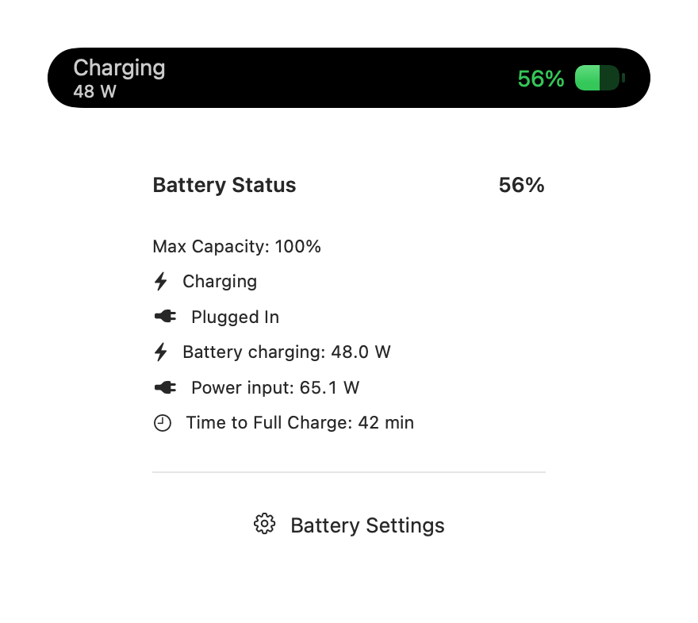

# Charging power

The charging HUD shows watts going into the battery. The battery popover labels this as **Battery charging** and separately shows **Power input**, the DC power received by the Mac (including system load). Neither value is the adapter's rated or negotiated capacity, nor a wall-socket measurement.

Readings use `AppleSmartBattery` through IOKit, without a helper process, elevated privileges or new dependencies. Battery watts are signed current in mA times voltage in mV divided by 1,000,000. Input watts are `PowerTelemetryData.SystemPowerIn` in mW divided by 1,000. IORegistry keys are not guaranteed on every Mac or OS release; unavailable, invalid, negative or disconnected readings are omitted. Battery charge watts are also omitted when macOS reports charging paused or stopped. Zero is retained when reported as a valid measurement.

Only visible battery popovers and charging HUDs sample, immediately and then every five seconds. SwiftUI cancels each sampling task when its view disappears. The operating system may refresh underlying telemetry less often than sampling occurs.

## Preview

Native SwiftUI render of the production popover and compact row with fixed test readings (48 W battery charging, 65.085 W DC input). This is a layout fixture, not a live-device screenshot or a complete notch integration test.

## Validation

Run `scripts/test_battery_power.sh` for standalone regression coverage of unit conversion, missing values, negative/unsigned discharge current, nonfinite input, stopped charging, zero readings and stale telemetry after unplugging. The test compiles the production IOKit reader and parser using the active Xcode toolchain and requires no app package dependencies.

The new popover and compact row were also compiled independently as native SwiftUI views. A live reader run while the Mac was disconnected returned no charging or input wattage, consistent with the system power source. Full app build and actual plug/replug HUD verification remain separate checks; package resolution was blocked locally by GitHub transport failures.
